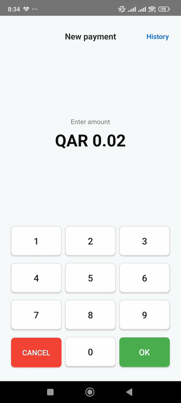
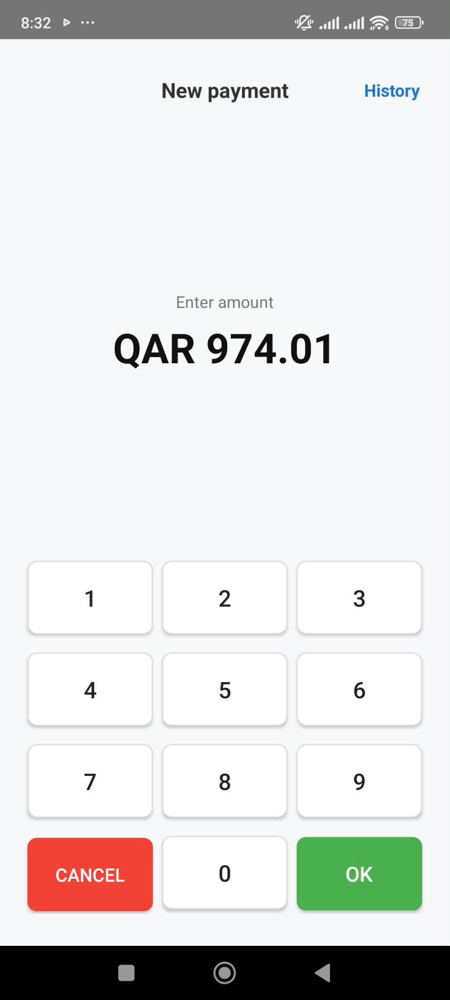
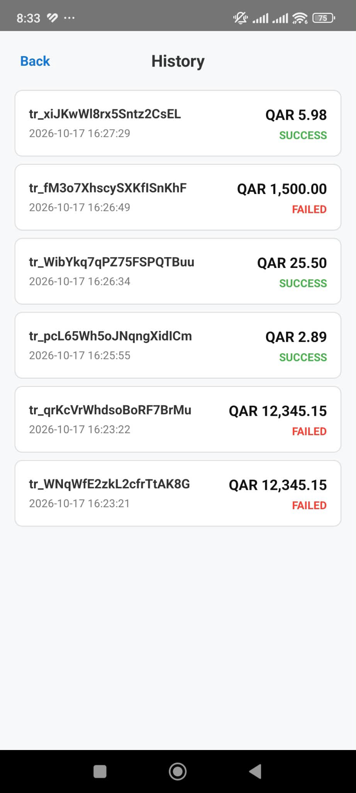
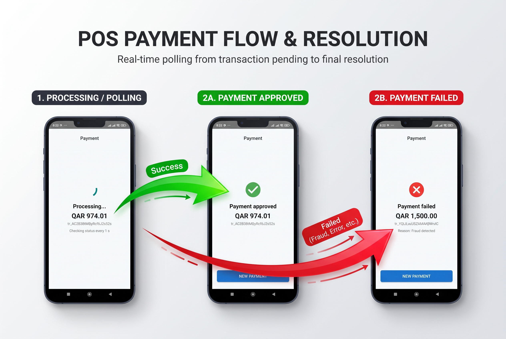

# POS Payment App

A lightweight Android point-of-sale app in Kotlin that takes an amount on a custom numpad, submits payment to the API, and monitors status until final resolution.

## App Flow Demo



---

## Screenshots

### 1. POS Amount Screen & Transaction History
<p align="left">
  
  &nbsp;&nbsp;&nbsp;&nbsp;
  
</p>

### 2. Transaction Results (Pending, Approved & Failed)


---

## Features Implemented

- **Amount Entry (Numpad)**:
  - Custom 4x3 numpad (digits entered in cents: `1`, `2`, `5`, `0` -> `0.01` -> `0.12` -> `1.25` -> `12.50`).
  - Formatted as `QAR 0.00`.
  - Capped at 7 digits (`max QAR 99,999.99`).
  - `Cancel` resets the amount to `QAR 0.00` and generates a fresh idempotency key.
  - `OK` is disabled while amount is `QAR 0.00`.

- **Payment Processing**:
  - `POST /pay` with amount in cents, currency `QAR`, and `X-Api-Key`.
  - Double-tap prevention and loading spinner.
  - Idempotency key (`UUID`) generated per payment and reused on retry.
  - 10-second network timeout.
  - In-place error display for `400`, `401`, `500`, or network failures.
  - `Retry` button on `500` and timeouts to resend with the same key and amount.

- **Status Polling**:
  - Automatically polls `GET /transactions/{id}` every 1 second until no longer `pending`.
  - Up to 15 attempts before showing `"Still processing, check later"`.
  - Clear **Success** ("Payment approved") and **Failed** ("Reason: Fraud detected") screens.
  - Polling stops immediately when the user leaves the screen.
  - `"New payment"` button returns to the amount screen with `QAR 0.00`.

- **Bonus Feature**:
  - **Transaction History**: Top-right button opens recent transactions list (`GET /transactions?limit=20`) showing status, amount, and timestamp.

---

## Testing with Local Mock Server

1. **Start the mock server**:
   ```bash
   cd server
   node pos_server.js
   ```

2. **If testing on a physical device over USB**:
   ```bash
   adb reverse tcp:8080 tcp:8080
   ```

3. **Test Scenarios**:
   - `QAR 25.50` (`2550`): Pending -> Approved.
   - `QAR 1,500.00` (`150000`): Pending -> Failed ("Fraud detected").
   - `QAR 10.99` (`1099`): HTTP 500 error on amount screen with Retry button.
   - `QAR 5.98` (`598`): Response takes 15s (tests timeout and retry).
